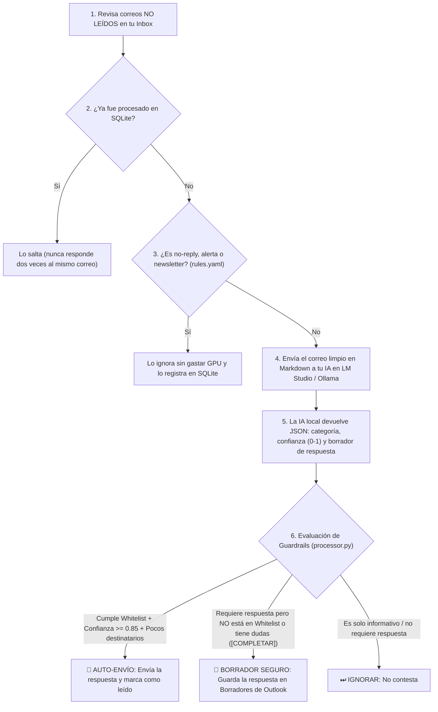

# M365 Local AI (MCP Server + Auto-Reply Worker)

Conecta tu Correo de M365 u Otlook classic y calendario de **Microsoft 365 (Outlook)** con **LM Studio**, **Ollama** y **Antigravity IDE** manteniendo tus datos **100% locales** La idea de este repo es mantener los datos locales, y por recomiendo usar modelos Open Source y alojados localmente. El MCP se puede conectar con herramientas como Claude, Antigravity o algún otro por medio del mcp server, sin embargo, úsalo bajo tu propio riesgo. No me hago responsable por el mal uso o datos exfiltrados hacia compañías de terceros, ni de los datos que puedan ser extraidos de tu máquina. Básicamente este software facilita el uso de herramientas de IA con tus datos personales, ya sea para análisis, automatización o cualquier otro fin.

Soporta dos modos de conexión intercambiables desde el archivo `.env`:
1. **`M365_BACKEND="outlook_local"` (Windows COM / MAPI):** Se conecta directamente a la aplicación de escritorio de Outlook en Windows. **No requiere permisos de Administrador TI ni registro en Azure Entra ID.**
2. **`M365_BACKEND="graph"` (Microsoft Graph API OAuth2):** Se conecta directamente a la nube de Microsoft 365 usando permisos delegados de usuario (ideal para cuentas personales `@hotmail.com`/`@outlook.com` o tenants corporativos sin bloqueo de consentimiento).

---

## Arquitectura y Módulos a Alto Nivel

| Módulo | Archivo | Descripción a alto nivel |
| :--- | :--- | :--- |
| **Selector de Conector** | `src/connectors/__init__.py` | `get_mail_client()` detecta automáticamente `M365_BACKEND` en `.env` y devuelve el cliente de nube (`GraphMailClient`) o el cliente local (`OutlookLocalClient`). |
| **Conector Cloud (Graph API)** | `src/connectors/graph_client.py` | Gestiona el flujo OAuth2 interactivo con `msal`, caché local cifrada/borrable (`.m365_token_cache.bin`), limpieza de HTML a Markdown y llamadas REST a `/me/messages` y `/me/calendarView`. |
| **Conector Local (Outlook COM)** | `src/connectors/outlook_com.py` | Interactúa con el proceso local `Outlook.Application` en Windows vía `pywin32`, resuelve direcciones internas de Exchange (`X500` → `SMTP`) y lee/escribe correos y eventos sin pasar por Azure AD. |
| **Proveedor de IA Local** | `src/llm/local_provider.py` | Conector compatible con la API OpenAI local de **LM Studio** (`:1234/v1`) y **Ollama** (`:11434/v1`). Clasifica correos entrantes y redacta borradores estructurados en JSON. |
| **Motor de Reglas y Guardrails** | `src/engine/processor.py` | Evalúa las sugerencias del modelo local frente a `config/rules.yaml` (lista blanca de remitentes/dominios, nivel mínimo de confianza y límite de destinatarios) antes de permitir un auto-envío. |
| **Auditoría SQLite** | `src/engine/db.py` | Registra cada correo procesado en `m365_audit.sqlite3` para evitar respuestas duplicadas y mantener trazabilidad local. |
| **Servidor MCP** | `src/mcp_server.py` | Expone las herramientas de correo, calendario y seguridad a **LM Studio** y **Antigravity** mediante el protocolo Model Context Protocol (`stdio`). |
| **Servicio Autónomo (Daemon)** | `src/daemon.py` | Proceso opcional en segundo plano que revisa correos no leídos periódicamente y crea borradores o responde según `config/rules.yaml`. |

---

## Herramientas MCP Disponibles (en LM Studio / Antigravity)

### 📬 Correo Electrónico
* **`list_emails(unread_only, limit, folder)`**: Lista los correos más recientes de una carpeta (`inbox`, `drafts`, `sentitems`) y les asigna un alias corto (`E1`, `E2`, `E3`...) para que los modelos locales los referencien sin errores.
* **`read_email(message_id)`**: Obtiene el contenido completo de un correo convertido a Markdown limpio (acepta el alias corto `E1`, el número `1`, el correo del remitente o el ID completo).
* **`search_emails(query, limit)`**: Busca correos por remitente, asunto o palabras clave.
* **`send_new_email(to_email, subject, body_markdown, cc_email)`**: Envía un correo electrónico nuevo desde cero a uno o varios destinatarios.
* **`create_new_email_draft(to_email, subject, body_markdown, cc_email)`**: Crea un borrador de un correo nuevo en la carpeta Borradores de Outlook sin enviarlo.
* **`create_reply_draft(message_id, reply_markdown, reply_all)`**: Crea un borrador de respuesta conservando el hilo original del correo recibido.
* **`send_reply_email(message_id, reply_markdown, reply_all)`**: Envía inmediatamente una respuesta sobre el hilo del correo recibido.
* **`analyze_and_reply_with_local_ai(message_id, custom_instructions, allow_auto_send)`**: Pide al modelo local que clasifique el correo, redacte la respuesta y aplique los guardrails de `config/rules.yaml`.

### 📅 Calendario y Planificación del Día
* **`get_day_schedule(date_yyyy_mm_dd)`**: Devuelve todas las reuniones del día (por defecto hoy), expande eventos recurrentes y calcula automáticamente los **huecos libres (`free_slots`)** en la mañana y en la tarde (`08:00` a `18:00`), incluyendo el indicador `is_afternoon_mostly_free`.
* **`get_upcoming_calendar_events(days_ahead)`**: Lista los eventos y reuniones de los próximos $N$ días (por defecto 7 días).
* **`create_calendar_event(subject, start_datetime, end_datetime, body_markdown, attendees_email, location)`**: Crea una reunión o bloque de enfoque en el calendario de Outlook en hora local (`YYYY-MM-DD HH:MM`).

### 🔒 Seguridad y Sesión
* **`get_account_profile()`**: Muestra qué cuenta de correo y qué modo (`outlook_local` o `graph`) están activos.
* **`logout_and_delete_token()`**: Sobrescribe con ceros (`\x00`) y elimina del disco el archivo `.m365_token_cache.bin` y la caché de IDs (también se ejecuta automáticamente al presionar **`Ctrl + C`** en `test_auth.py` o `daemon.py`).
* **`get_audit_history(limit)`**: Consulta el historial SQLite de correos procesados por la IA local.

---

## Instalación Rápida (Si clonas desde GitHub)

```powershell
git clone https://github.com/TU_USUARIO/m365-local-ai.git
cd m365-local-ai
python -m venv .venv
.\.venv\Scripts\Activate.ps1
pip install -e .
copy .env.example .env
copy config\rules.example.yaml config\rules.yaml
copy config\prompts.example.yaml config\prompts.yaml
```

---

## Configuración (`.env`)

1. **Para cuentas corporativas con bloqueo de Azure AD (Modo Local):**
   ```env
   M365_BACKEND="outlook_local"
   M365_ACCOUNT_EMAIL=""
   ```
   *(Solo necesitas tener abierto Outlook clásico de escritorio en Windows).*

2. **Para cuentas personales (`@hotmail.com`/`@outlook.com`) o tenants abiertos (Modo Graph API):**
   ```env
   M365_BACKEND="graph"
   M365_CLIENT_ID="tu-application-client-id"
   M365_TENANT_ID="common"
   ```
   *(Registra una app gratuita en [portal.azure.com](https://portal.azure.com) → Microsoft Entra ID → App registrations → Redirect URI `Public client/native`: `http://localhost` y activa `Allow public client flows = Yes`).*

---

## Ejecución y Uso

### 1. Probar conexión e iniciar sesión
Haz doble clic en **`iniciar_login.bat`** o ejecuta en PowerShell:
```powershell
python test_auth.py
```
*(Al terminar de trabajar, presiona **`Ctrl + C`** en esa ventana para destruir y eliminar el token local de forma segura).*

### 2. Conectar como Servidor MCP en LM Studio o Antigravity
Agrega este bloque en tu archivo `mcp.json`:

```json
{
  "mcpServers": {
    "m365-local-ai": {
      "command": "C:\\ruta\\a\\tu\\proyecto\\m365-local-ai\\.venv\\Scripts\\python.exe",
      "args": [
        "-m",
        "src.mcp_server"
      ],
      "cwd": "C:\\ruta\\a\\tu\\proyecto\\m365-local-ai"
    }
  }
}
```

### 3. Ejecutar el Piloto Automático en Segundo Plano (`src/daemon.py`)

Mientras que el **Servidor MCP** espera a que tú le hables en el chat de LM Studio, el **Daemon (`src/daemon.py`)** funciona como un **asistente autónomo en segundo plano** que vigila tu bandeja de entrada y prepara (o envía) respuestas por ti sin que tengas que pedírselo correo por correo.

#### ¿Qué hace exactamente el Daemon en cada ciclo?



#### Las 4 garantías de seguridad del Daemon:
1. **Nunca responde dos veces al mismo mensaje:** Cada correo analizado se guarda con su `message_id` en la base de datos local `m365_audit.sqlite3`.
2. **Ahorro de recursos (Pre-filtrado):** Correos de tipo `no-reply@`, `notifications@` o boletines (`ignore_rules` en `config/rules.yaml`) se descartan antes de llamar a tu tarjeta gráfica.
3. **Borrador por defecto, Auto-envío solo bajo Lista Blanca:**
   * Si te escribe alguien que **NO** está en tu lista blanca (`whitelist` en `config/rules.yaml`), o si hay más de 3 personas en copia, o si la IA dejó algún dato pendiente como `[COMPLETAR FECHA]`, el Daemon **jamás enviará el correo**: únicamente te dejará el borrador listo en tu carpeta **Borradores** de Outlook para que tú lo revises y le des a Enviar.
   * Solo enviará la respuesta automáticamente si `enable_auto_send: true`, el remitente/dominio está en tu `whitelist` y la confianza del modelo supera el mínimo (`0.85`).
4. **Modo Simulación (`DRY_RUN=true`):** Si activas `DRY_RUN=true` en tu `.env`, el Daemon analizará tus correos con la IA y te mostrará en consola qué habría hecho (*"Se habría creado borrador"* / *"Se habría enviado auto-respuesta"*), pero sin tocar ni enviar nada en tu Outlook.

#### Comandos para usar el Daemon:
* **Hacer una sola pasada de revisión y terminar** (ideal para probarlo cuando abres tu PC):
  ```powershell
  python -m src.daemon --once
  ```
* **Dejarlo vigilando tu bandeja continuamente** (revisa cada `POLL_INTERVAL_SECONDS=120` segundos; presiona **`Ctrl + C`** para detenerlo y destruir el token local):
  ```powershell
  python -m src.daemon
  ```
